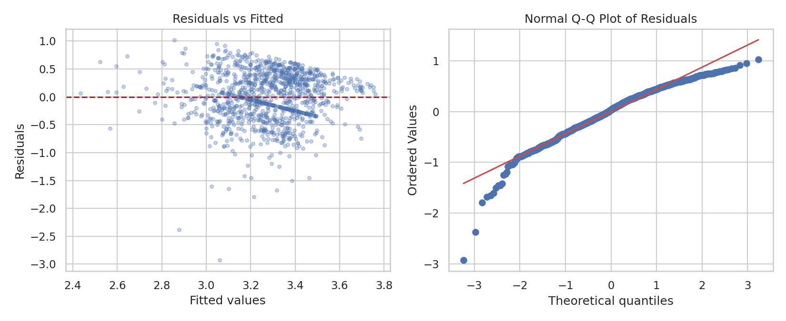
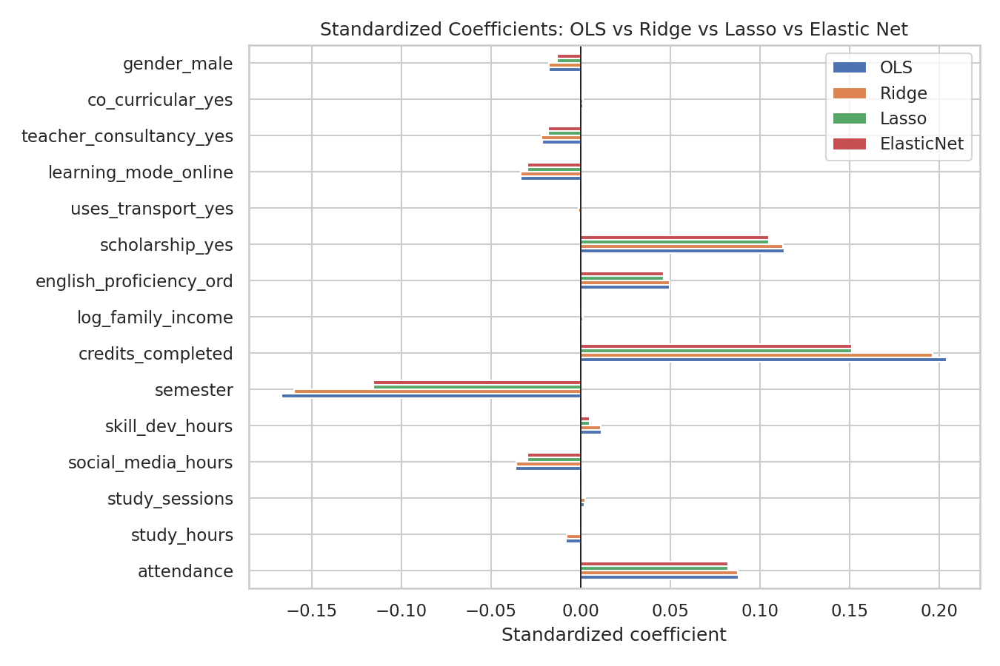
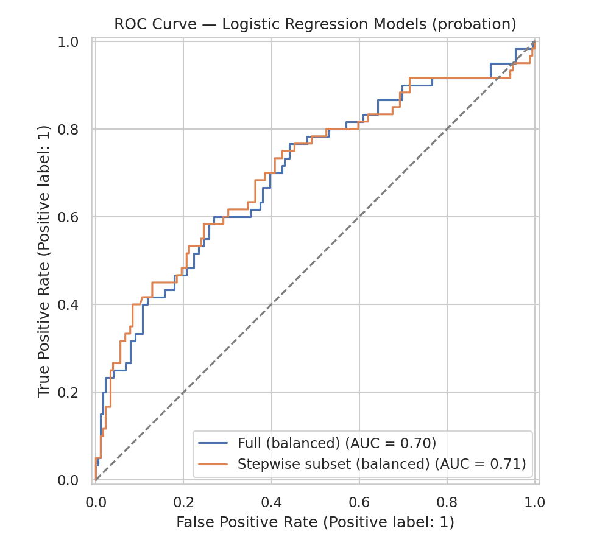
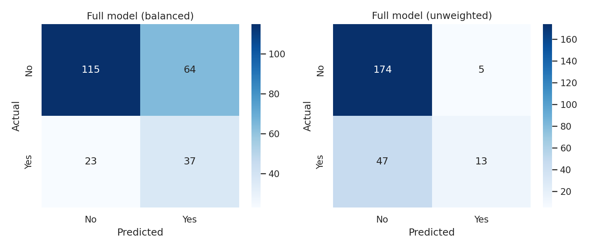

# Task 5 — Predictive Statistical Modelling

Run `python src/task5_modelling.py` (after `clean_data.py`) to regenerate
every number below. Full console output is saved to
`outputs/tables/task5_results.txt`; all coefficient/comparison tables are
also saved as CSVs in `outputs/tables/`.

**Implementation note:** `statsmodels` is not available in this environment,
so `src/model_prep.py` supplies a curated predictor matrix, and
`src/task5_modelling.py` implements Ordinary Least Squares and a Binomial
GLM (logistic regression) **from first principles** using `numpy`/`scipy`
(closed-form OLS via the normal equations, and logistic regression via
Iteratively Reweighted Least Squares), so that full inferential output
(standard errors, t/z-statistics, p-values, confidence intervals) is
available, not just point predictions. `scikit-learn` is used for
regularized regression (Ridge/Lasso/Elastic Net) and for the predictive
train/test evaluation.

## 5.0 Predictor set and targets
Two prediction targets, chosen to match Task 1's stated objectives:
- **`current_cgpa`** (continuous) — multiple linear regression / regularized regression
- **`probation`** (binary Yes/No) — logistic regression / GLM

**15 predictors** used for both models (see `src/model_prep.py` for full
rationale): `attendance`, `study_hours`, `study_sessions`,
`social_media_hours`, `skill_dev_hours`, `semester`, `credits_completed`,
`log_family_income`, `english_proficiency` (ordinal), `scholarship`,
`uses_transport`, `learning_mode` (online/offline), `teacher_consultancy`,
`co_curricular`, `gender`.

`previous_sgpa` and `current_cgpa` were **deliberately excluded** as
predictors of `probation` (temporal circularity — probation and CGPA are
two views of the same academic outcome). `previous_sgpa` is examined
separately, as a sensitivity check, for the CGPA regression only (§5.1.2).
`program` (constant), `skills`/`interested_area` (high-cardinality free
text), `admission_year`/`hsc_year` (redundant with age/semester), and a
handful of near-zero-variance fields were excluded for parsimony —
see `model_prep.py` docstring for the full list and reasoning.

## 5.1 Multiple Linear Regression (OLS) — target: `current_cgpa`

n = 1,155 (rows with non-missing CGPA and all 15 predictors). **R² = 0.146,
Adjusted R² = 0.135.** Overall F-test: F = 13.03, p < 0.0001 — the model as
a whole is significant, though it only explains ~14% of the variance in
CGPA (expected: behavioural survey data cannot fully explain an outcome
also driven by unmeasured ability, effort consistency, and course
difficulty — see §5.1.3 for a comparison against a model that also uses
prior grades).

| Predictor | Coef | Std err | t | p | |
|---|---|---|---|---|---|
| Intercept | 2.799 | 0.251 | 11.15 | <0.0001 | \*\*\* |
| attendance | 0.0057 | 0.0009 | 6.53 | <0.0001 | \*\*\* |
| study_hours | 0.0010 | 0.0089 | 0.11 | 0.910 | |
| study_sessions | −0.0014 | 0.0167 | −0.08 | 0.934 | |
| social_media_hours | −0.0167 | 0.0059 | −2.83 | 0.0047 | \*\* |
| skill_dev_hours | 0.0039 | 0.0105 | 0.37 | 0.708 | |
| semester | −0.0397 | 0.0082 | −4.85 | <0.0001 | \*\*\* |
| credits_completed | 0.0041 | 0.0007 | 5.88 | <0.0001 | \*\*\* |
| log_family_income | −0.0117 | 0.0217 | −0.54 | 0.590 | |
| english_proficiency (ord) | 0.0668 | 0.0219 | 3.05 | 0.0023 | \*\* |
| scholarship = Yes | 0.2472 | 0.0298 | 8.30 | <0.0001 | \*\*\* |
| uses_transport = Yes | −0.0043 | 0.0272 | −0.16 | 0.875 | |
| learning_mode = Online | −0.0682 | 0.0295 | −2.31 | 0.021 | \* |
| teacher_consultancy = Yes | −0.0368 | 0.0270 | −1.36 | 0.173 | |
| co_curricular = Yes | −0.0055 | 0.0271 | −0.20 | 0.839 | |
| gender = Male | −0.0308 | 0.0274 | −1.12 | 0.261 | |

*(\* p<0.05, \*\* p<0.01, \*\*\* p<0.001)*

**Practical interpretation:** holding other factors constant, attendance,
scholarship status, credits completed, and English proficiency are
positively associated with CGPA; social media hours, semester (more
advanced students trend slightly lower, plausibly reflecting harder
upper-level coursework), and online learning mode are negatively
associated. Daily study hours/sessions and skill-development hours are
**not** significant once the other variables are controlled for — a
genuinely useful (if counter-intuitive) finding for the consultancy: raw
self-reported study time is a weaker lever than attendance and scholarship
status once everything else is accounted for.

### 5.1.1 Assumption checks
- **Multicollinearity (VIF):** all predictors have VIF < 7; `semester`
  (5.39) and `credits_completed` (6.16) are the highest, as expected since
  both track academic progress, but neither crosses the serious-concern
  threshold of 10.
- **Homoscedasticity:** a regression of squared residuals on fitted values
  gives p = 0.0011 → mild evidence of **heteroscedasticity**.
- **Normality of residuals:** Shapiro-Wilk W = 0.964, p < 0.0001 →
  residuals **deviate from normality**, visible as a left skew in the Q-Q
  plot (`outputs/figures/ols_residual_diagnostics.png`).
- **Why:** `current_cgpa` is bounded on [0, 4] with a pile-up of students
  near the 4.0 ceiling and a long left tail toward 0 — a genuinely
  non-normal, non-constant-variance outcome for an unbounded linear model.
  With n = 1,155 the coefficient p-values are still broadly trustworthy
  (large-sample robustness of OLS inference to moderate non-normality),
  but this is flagged as a real limitation: a **bounded/Beta regression or
  Tobit model** would be a more statistically appropriate choice for CGPA
  as a future refinement, beyond this course's required toolkit.

### 5.1.2 Sensitivity check — adding `previous_sgpa`
Adding `previous_sgpa` (n = 1,153) raises R² from 0.146 to **0.605**
(previous_sgpa coefficient = 0.538, p < 0.0001) — by far the single
strongest predictor of current CGPA, as expected (past performance
predicts future performance). The 15-predictor behavioural model above is
retained as the **primary** model for the consultancy report because it
targets levers the department can actually act on (attendance, study
habits, scholarship policy); `previous_sgpa` is a useful benchmark/control
but not something the university can intervene on.

## 5.2 Logistic Regression as a GLM (Binomial family, logit link) — target: `probation`
n = 1,194 (no missing target). Positive rate (probation = Yes) = 25.0%.
Fit via Iteratively Reweighted Least Squares. McFadden's pseudo-R² = 0.116
(a "good" fit by McFadden's own rule of thumb, which considers 0.2–0.4
excellent — this is a moderate, plausible fit for behavioural survey
predictors of a complex outcome).

| Predictor | Coef | Std err | z | p | Odds ratio | 95% CI | |
|---|---|---|---|---|---|---|---|
| Intercept | −1.051 | 1.334 | −0.79 | 0.431 | 0.350 | [0.026, 4.776] | |
| attendance | −0.0287 | 0.0044 | −6.48 | <0.0001 | **0.972** | [0.963, 0.980] | \*\*\* |
| study_hours | −0.0392 | 0.0497 | −0.79 | 0.431 | 0.962 | [0.872, 1.060] | |
| study_sessions | 0.0579 | 0.0919 | 0.63 | 0.529 | 1.060 | [0.885, 1.269] | |
| social_media_hours | −0.0337 | 0.0329 | −1.03 | 0.305 | 0.967 | [0.907, 1.031] | |
| skill_dev_hours | 0.0317 | 0.0562 | 0.56 | 0.572 | 1.032 | [0.925, 1.153] | |
| semester | 0.2057 | 0.0458 | 4.49 | <0.0001 | **1.228** | [1.123, 1.344] | \*\*\* |
| credits_completed | −0.0099 | 0.0039 | −2.57 | 0.010 | **0.990** | [0.983, 0.998] | \* |
| log_family_income | 0.2028 | 0.1155 | 1.76 | 0.079 | 1.225 | [0.977, 1.536] | |
| english_proficiency (ord) | −0.2798 | 0.1193 | −2.35 | 0.019 | **0.756** | [0.598, 0.955] | \* |
| scholarship = Yes | −0.7661 | 0.1690 | −4.53 | <0.0001 | **0.465** | [0.334, 0.647] | \*\*\* |
| uses_transport = Yes | −0.2234 | 0.1504 | −1.49 | 0.137 | 0.800 | [0.596, 1.074] | |
| learning_mode = Online | 0.1726 | 0.1578 | 1.09 | 0.274 | 1.188 | [0.872, 1.619] | |
| teacher_consultancy = Yes | −0.0172 | 0.1474 | −0.12 | 0.907 | 0.983 | [0.736, 1.312] | |
| co_curricular = Yes | 0.3106 | 0.1463 | 2.12 | 0.034 | **1.364** | [1.024, 1.817] | \* |
| gender = Male | 0.1329 | 0.1496 | 0.89 | 0.375 | 1.142 | [0.852, 1.531] | |

**Practical interpretation (significant effects only):**
- **Attendance** (OR = 0.972): each extra percentage point of attendance
  is associated with **2.8% lower** odds of ever having been on probation
  — the single clearest, most actionable early-warning signal in the
  dataset, and consistent with Task 4.1b.
- **Scholarship** (OR = 0.465): scholarship holders have **53.5% lower**
  odds of a probation history, consistent with Task 4.2a.
- **English proficiency** (OR = 0.756 per ordinal step): higher English
  proficiency is associated with **24.4% lower** odds of probation.
- **Semester** (OR = 1.228): each additional semester is associated with
  **22.8% higher** odds — more time enrolled means more opportunity to
  have fallen into probation at some point, so this partly reflects
  exposure time rather than a risk factor to intervene on.
- **Credits completed** (OR = 0.990): more credits completed is associated
  with slightly lower odds, plausibly reflecting steadier academic
  progress.
- **Co-curricular engagement** (OR = 1.364, p = 0.034, the weakest of the
  significant effects): counter-intuitively associated with **higher**
  odds of probation. Two plausible readings: (a) time spent on
  co-curricular activities competes with study time, or (b) reverse
  causality — students already struggling seek extracurricular outlets.
  The data cannot distinguish these; flagged as a discussion point rather
  than a confident recommendation.

## 5.3 Regularized regression (Ridge / Lasso / Elastic Net) — target: `current_cgpa`
80/20 train-test split, predictors standardized, penalty strength chosen by
5-fold cross-validation.

- Ridge: α = 3.56 (chosen from a log-spaced grid)
- Lasso: α = 0.0054
- Elastic Net: α = 0.0054, l1_ratio = 1.0 (cross-validation selected pure
  L1 — Elastic Net collapses to Lasso here, meaning the extra L2 flexibility
  wasn't needed for this data)

| Predictor | OLS | Ridge | Lasso | Elastic Net |
|---|---|---|---|---|
| attendance | 0.088 | 0.088 | 0.083 | 0.083 |
| study_hours | −0.008 | −0.008 | **0.000** | **0.000** |
| study_sessions | 0.002 | 0.003 | **0.000** | **0.000** |
| social_media_hours | −0.036 | −0.036 | −0.030 | −0.030 |
| skill_dev_hours | 0.012 | 0.012 | 0.005 | 0.005 |
| semester | −0.167 | −0.160 | −0.116 | −0.116 |
| credits_completed | 0.204 | 0.197 | 0.151 | 0.151 |
| log_family_income | 0.001 | 0.002 | 0.001 | 0.001 |
| english_proficiency | 0.050 | 0.050 | 0.046 | 0.046 |
| scholarship = Yes | 0.114 | 0.113 | 0.105 | 0.105 |
| uses_transport = Yes | −0.001 | −0.001 | **0.000** | **0.000** |
| learning_mode = Online | −0.033 | −0.033 | −0.030 | −0.030 |
| teacher_consultancy = Yes | −0.022 | −0.022 | −0.018 | −0.018 |
| co_curricular = Yes | 0.001 | 0.001 | **0.000** | **0.000** |
| gender = Male | −0.018 | −0.018 | −0.013 | −0.013 |

(coefficients are on standardized predictors, so directly comparable)

Lasso zeroes out `study_hours`, `study_sessions`, `uses_transport`, and
`co_curricular` — the same variables that were non-significant in the OLS
table above (§5.1). This cross-validates the OLS significance results
using a completely different method: both approaches agree these four
variables add negligible predictive value once the others are included.

## 5.4 Variable selection: best subset, forward, and backward stepwise

**Exhaustive best subset** was run over the **9 numeric predictors only**
(2⁹ = 511 models — computationally feasible; exhaustive search over all 15
predictors, including dummy variables, would require 2¹⁵ = 32,768 models
and was judged unnecessary given stepwise methods below already do this
efficiently).

- Best subset by AIC (k=5): `attendance, social_media_hours, semester,
  credits_completed, english_proficiency` — AIC = −1784.2, Adj R² = 0.084
- Best subset by BIC: identical set (AIC and BIC agree here)

**Forward stepwise** and **backward stepwise** selection (AIC-based,
greedy) were then run over the **full 15-predictor set** (numeric +
categorical dummies):

- Forward: `scholarship, attendance, credits_completed, semester,
  social_media_hours, english_proficiency, learning_mode` (k=7,
  final AIC = −1853.8)
- Backward: **identical set** to forward (k=7, final AIC = −1853.8)

**Forward and backward stepwise agree exactly** — a reassuring sign that
this isn't an artefact of search order. Adding `scholarship` and
`learning_mode` (only available once categorical predictors are in scope)
drops AIC by ~70 points versus the best numeric-only subset, showing
scholarship status in particular is one of the most useful predictors in
the whole set, consistent with §5.1 and Task 4.1a/4.2a.

## 5.5 Model comparison and evaluation

### Regression (current_cgpa), 20% held-out test set (n=231)
| Model | Train RMSE | Test RMSE | Test R² |
|---|---|---|---|
| OLS (full, 15 predictors) | 0.455 | 0.402 | 0.164 |
| OLS (stepwise subset, k=7) | 0.456 | 0.400 | 0.172 |
| Ridge (CV-tuned) | 0.455 | 0.402 | 0.165 |
| Lasso (CV-tuned) | 0.456 | **0.399** | **0.177** |
| Elastic Net (CV-tuned) | 0.456 | **0.399** | **0.177** |

All five models perform within a very narrow band (test RMSE 0.399–0.402);
the differences are not practically meaningful. Lasso/Elastic Net edge out
marginally on the held-out set while also being the simplest (11 of 15
coefficients retained, four zeroed).

### Classification (probation), 20% held-out stratified test set (n=239)
| Model | Accuracy | Precision | Recall | F1 | AUC |
|---|---|---|---|---|---|
| Logistic (full, 15 predictors, balanced) | 0.636 | 0.366 | **0.617** | 0.460 | 0.701 |
| Logistic (stepwise subset, k=7, balanced) | 0.644 | 0.374 | **0.617** | 0.465 | 0.705 |
| Logistic (full, 15 predictors, unweighted) | **0.782** | **0.722** | 0.217 | 0.333 | 0.706 |

Confusion matrices (rows = actual, columns = predicted [No, Yes]):

- Balanced (full): `[[115, 64], [23, 37]]`
- Unweighted (full): `[[174, 5], [47, 13]]`

**Interpretation:** AUC is nearly identical across all three (0.70–0.71) —
the model's underlying ranking ability doesn't change much with weighting
or the choice of predictor subset. What changes dramatically is the
**trade-off the department is making**: the unweighted model has higher
accuracy but only catches 13 of 60 at-risk students in the test set
(recall 21.7%) — it defaults to predicting "No probation" for almost
everyone, since that's the majority class. The class-balanced model
catches 37 of 60 (recall 61.7%) at the cost of more false alarms
(64 students flagged who were not actually on probation). For an
**early-warning system** (Task 1's stated goal), missing an at-risk
student is more costly than a false alarm that simply triggers an extra
advising conversation — so the balanced model is the better operational
choice despite its lower raw accuracy.

## 5.6 Recommended models
- **CGPA:** the **stepwise-selected OLS model (k=7 predictors)** —
  statistically indistinguishable performance from the full model and the
  regularized alternatives, but far easier to explain to non-technical
  stakeholders (department administration, scholarship committee) with
  only 7 named factors instead of 15.
- **Probation risk:** the **class-balanced logistic/GLM model**, on either
  the full or stepwise predictor set (both perform similarly) — prioritizes
  recall to match the early-warning use case, and its coefficients
  (§5.2) directly answer Task 1's objective of quantifying which
  controllable factors matter most: **attendance and scholarship status**
  are the two strongest, most actionable levers.

Both recommended models are limited by modest explanatory power (R² ≈ 0.15
for CGPA, pseudo-R² ≈ 0.12 for probation) — expected for behavioural
survey data predicting complex academic outcomes, and worth stating plainly
in the final consultancy recommendations (Task 12) rather than
overselling model accuracy.
